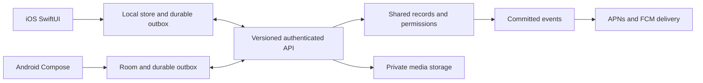

# Android scope for Plated

Date: October 17, 2026. Status: proposed, for product and architecture review.

## Recommendation

Keep the SwiftUI iOS app. Build Android with Kotlin and Jetpack Compose. Introduce a platform-neutral backend for shared product data, with Supabase/Postgres the leading candidate because Plated already operates services there. Move iOS onto that shared contract as part of the project.

Android is feasible, but the largest dependency is replacing Apple-specific household sharing. A credible Android release lets an Android member join an iPhone household and participate equally. A separate Android-only household product would be cheaper initially, but would not satisfy that goal.

Begin with a time-boxed, two-to-three engineer-week discovery and interoperability spike. Prove identity, invitation, one planned meal, grocery marks, offline retries, and an iOS migration sample before committing to the full schedule.

This assessment is based on the current working tree, including uncommitted changes, repository contracts, selected implementation paths, and official platform documentation. It is not a runtime audit of production, a measured porting benchmark, or a vendor quote. No app code or deployed services were changed. Existing release gates remain unverified by this assessment.

## What exists today

The app and widgets contain 163 Swift files and approximately 61,900 lines, including comments and support code. This is an inventory signal, not an effort estimator. Imports include SwiftData in 79 files, SwiftUI in 65, UIKit in 25, and CloudKit in 10. There is no existing Android client identified in the app layout.

The relevant architecture has several distinct stores:

| Layer | Current implementation | Android consequence |
|---|---|---|
| UI | SwiftUI, UIKit bridges, Editorial design tokens | Rebuild UI; preserve brand and behavior |
| Personal persistence | SwiftData with automatic private CloudKit mirroring | Android needs its own local database and account sync |
| Shared household | Explicit CloudKit zone/share for roster, recipes, gatherings, grocery facts | Replace or prove an alternative transport for both platforms |
| Shared plan | CloudKit plan records, local PlannedMeal rows, PlanLedger overlays and edit queues | Specify ownership and conflict rules before translating |
| Table | Separate CloudKit share, posts/comments, ledger and durable outbox | Preserve separation from private household data |
| Identity | CloudKit user record names plus Sign in with Apple and directory sessions | Introduce one application user identity and explicit legacy mappings |
| Server | Supabase directory, invitations, push support, deletion, admin and waitlist services; Instacart integration code | Useful foundation, not an existing complete meal-planning backend |
| Website | Marketing, invitation landing, privacy, early access and founder console | No existing full browser meal-planning client to wrap |
| System features | WidgetKit, ActivityKit, App Intents, EventKit, Vision, WeatherKit, APNs | Native Android replacements or explicit product substitutions |

Important scope corrections:

- Prongsby is disabled by `ProngsbyFeature.isEnabled = false`. Foundation Models code exists, but an Android AI assistant is not required for current launch parity.
- The README says the share-extension source is not embedded in the shipping archive. Android incoming shares would be an enhancement or a deliberately included convenience, not a mandatory copy of a shipped iOS feature.
- `DirectMessage.swift` describes local/iCloud conversation storage, not a working cross-user delivery backend. Real messaging is new product scope.
- Public discovery, payments, Watch, nutrition and HealthKit are outside the documented iOS 1.0 scope.
- The Instacart integration README records missing partner-key/live-checkout verification at its last update. Its current production activation must be checked separately; code presence is not evidence of a working partner integration.

Primary repository evidence: [README](../README.md), [store](../Plated/Support/PlatedStore.swift), [household contract](household.md), [plan contract](plan-share.md), [identity](../Plated/Services/TableIdentity.swift), [directory](../Plated/Services/Directory.swift), [push registration](../supabase/functions/device/index.ts), [feature flag](../Plated/Support/ProngsbyFeature.swift), [Instacart status](../backend/instacart/README.md).

## Product boundaries and parity

Recommended first release is a deliberately scoped mixed-platform household beta. Full public parity follows after the shared foundation is reliable.

| Capability | Mixed-platform beta | Broader parity/release work |
|---|---|---|
| Onboarding/account | Create/sign in, recover account, join existing household, optional local start if retained | Provider linking, device/account switching and polished recovery |
| Household | Roster, named non-account seats, cook assignments, dietary notes, invite/join/leave/remove | Ownership departure/transfer policy, richer profiles and stats |
| Plan | Week, four meal slots, recipe/freeform entries, servings, move/remove, cooked state | Month, gatherings, rotation refinements and full interaction parity |
| Cookbook | Manual creation/editing, ingredients, instructions, timing, photos, favorites/pins, URL/paste import | OCR scan, multiple-photo polish, export/print and richer filtering |
| Groceries | Derived quantities, meal/date selection, manual additions, shared check/uncheck, pantry rules | Instacart activation and external list integrations |
| Cook mode | Steps, local session resume, reliable timer, finish/cooked history | Rich lock-screen surface and advanced timer interactions |
| Table | Deferred from restricted beta, clearly disclosed | Posts, comments, polls, reactions, save recipes, reporting/blocking, activity and attribution |
| Notifications | Invites, essential reminders, deep links, settings | Full Table news/digest behavior, deduplication across devices |
| Widgets | Deferred | Start with Tonight and Groceries, then Cookbook, Table and cook turns |
| Calendar/weather | Deferred | Calendar export/context and forecast-driven suggestions |
| Insights/awards | Correct cooked history retained | Full summaries, personal versus household counts, awards |
| Accessibility | TalkBack, scalable text, touch targets, reduced motion, contrast | Continuous acceptance requirement, never a post-launch add-on |
| Privacy/deletion | Required even for beta handling real data | Updated disclosures, support and operational processes |

The beta is not advertised as full Plated parity. If all four rooms must exist on Android at first public launch, include the Table work before that launch. Deferring a Table screen does not permit exposing Table guests to household records.

## Architecture decision record

Status: Proposed. Decider: product owner, with implementation estimates validated by whoever will build and maintain Android/backend/iOS.

### Client options

| Option | Benefits | Costs and consequences | Assessment |
|---|---|---|---|
| Native Kotlin/Compose plus existing SwiftUI | Preserves iOS investment; direct Android lifecycle, accessibility and system integration | Two UIs and some duplicated domain code; needs Android expertise | Recommended for current product |
| Kotlin Multiplatform shared logic, native UIs | Potential sharing of new validation, calculations, network and sync code | Existing Swift business logic still must be ported; iOS integration and tooling work | Revisit after stable contracts; optional small experiment |
| React Native for Android, later iOS | TypeScript familiarity may help if team is web-heavy | Existing Next.js pages and SwiftUI screens do not become mobile screens automatically; Apple/native integrations still need adapters | Reasonable staffing-driven alternative, not an automatic shortcut |
| Flutter for both platforms | Shared new UI and domain implementation | Rebuilds the existing iOS UI; Dart adoption; platform integrations remain | Best only if deliberately replacing both clients |
| Responsive web/PWA, optionally packaged | Easier distribution and a future desktop surface | New product UI and backend still needed; timers, background behavior and native integrations need separate validation | Useful narrower companion product, not equivalent parity |
| Swift-based Android experimentation | Could preserve selected pure logic | Does not make SwiftUI, SwiftData, CKShare or Apple system frameworks portable | Do not put on the initial critical path |

These comparisons are engineering judgments about this repository, not measured productivity claims. React Native explicitly supports platform-specific code; Flutter uses platform channels for native calls. Both still require platform work. [React Native documentation](https://reactnative.dev/docs/platform-specific-code), [Flutter documentation](https://docs.flutter.dev/platform-integration/platform-channels).

### Backend options

1. **Platform-neutral shared backend: recommended.** Model users, households, membership, meals, recipes, groceries and Tables independently of Apple accounts. Retain offline local storage on each client. Supabase is the first candidate to validate; Firebase or a custom service are alternatives if team experience or offline tooling changes the decision.
2. **Keep CloudKit behind an Android/web adapter: investigate only as a bounded alternative.** Apple has HTTP CloudKit web services, so it is incorrect to claim non-Apple access is impossible. However, that does not prove the existing SwiftData private mirror, shared zones, identity, invitation acceptance and background delivery work acceptably for Android. Require a real-device proof covering those exact paths, including an Android-only person and expired sessions. [Apple CloudKit web services](https://developer.apple.com/library/archive/documentation/DataManagement/Conceptual/CloudKitWebServicesReference/).
3. **Permanent bidirectional CloudKit/backend bridge: high complexity.** Every edit needs identity translation, conflict resolution, deletion handling, media movement and loop prevention. It must not require the household owner's iPhone to stay online. Use a bridge only with a demonstrated ownership model and a retirement plan.
4. **Separate Android backend with no shared iPhone households:** suitable only if product requirements explicitly accept the split. It loses a principal reason to add Android.

Consequences of the recommendation: Android becomes practical, backend permissions can be consistent across clients, and future web clients become easier. Plated also takes on storage, availability, abuse handling, backup and user-data responsibilities currently carried largely by iCloud. iOS needs substantial data-layer work.

## Proposed target architecture

On Android, use repositories, Room for persistent structured data, observable state for UI, and WorkManager for durable eventual synchronization. Background synchronization is not a precision timer service. Local data drives rendering; the backend arbitrates committed shared changes. This matches Android's offline-first guidance. [Android offline-first architecture](https://developer.android.com/topic/architecture/data-layer/offline-first).

On iOS, extract repository boundaries around current services and screen queries. A local SwiftData store may remain useful, but migrated shared entities must not also participate in automatic CloudKit mirroring. Design separate legacy and migrated storage/configuration explicitly, with an audited import. Changing one configuration flag on the existing live store is not a migration plan.

Define a versioned API/fixture package before either client implements it. Candidate entities are users/provider identities, households, memberships/seats, scoped invitations, recipes/ingredients/media, planned meals, cooked events, gatherings, manual grocery lines/check facts, personal preferences, Tables/memberships/posts/comments/reactions/ballots, notification events and device registrations.

### Rules the shared contract must preserve

- Use stable application IDs. CloudKit record names, Apple sign-in subjects and directory user IDs are different identities; never assume equality. Link verified identities explicitly. Never merge accounts solely because names or email strings match.
- Separate an account from a household seat: children and other named people may have no account. A Table guest is not a household member.
- Authorize reads, writes, role changes and media access on the server. Clients cannot grant themselves membership or owner status. Test Table-only access against every household route.
- Use idempotency keys for operations, server revisions for conflict checks, durable local queues and resumable change cursors. Realtime and push are hints to fetch durable state, not the only delivery mechanism.
- Keep deletion/tombstone semantics explicit. A stale edit cannot resurrect a removed meal. Preserve cooked history and active cook sessions according to the existing contract.
- Specify conflicts per entity. Do not substitute one global timestamp rule for recipe conflicts, personal-profile ownership, grocery toggles, polls and plan edits.
- Keep meal calendar dates distinct from instants, with explicit timezone rules for reminders. Test daylight saving, midnight travel, week starts and clock skew.
- Share grocery facts and deterministic derivation rules. Canonical ingredient/unit keys, scaling, pantry flags, manual entries and check/uncheck must produce the same result in Swift and Kotlin. Preserve unlike units rather than guessing conversions.
- Keep personal favorites/pins and device-local calendar IDs separate from household records. Decide explicitly whether personal preferences sync across a person's platforms.
- Do not port local retention windows into the new database accidentally. Define historical meal/cook retention and what new members can see.
- Keep notification authorship, audience, quiet preferences and own-action suppression consistent. Persist committed events before dispatch and deduplicate delivery.
- Bound media size, generate thumbnails, resume uploads, remove abandoned assets and authorize downloads. Define what remains usable offline when photos are not yet cached.

If Supabase is chosen, use explicit grants plus row-level security for exposed tables and membership-based policies. Keep privileged service credentials server-side; enforce equivalent authorization inside privileged functions. Realtime does not supply this app's conflict, migration or local outbox contract automatically. [Supabase RLS guidance](https://supabase.com/docs/guides/database/postgres/row-level-security).

## Apple integrations: Android treatment

| Existing feature | Proposed treatment and remaining design work |
|---|---|
| Sign in with Apple / Keychain | Platform-neutral session with secure credential storage; choose Google and/or email entry, retain an Apple linking path for existing users. Verify cross-provider recovery and logout |
| CKShare invitations | HTTPS invitation with scoped, expiring, revocable token; authenticated redemption, seat binding and replay prevention; Android App Links plus existing iOS universal links |
| MessageUI / Contacts | System share composer/contact picker where appropriate; no automatic SMS sending or broad address-book upload introduced |
| APNs / CloudKit subscriptions | FCM delivery alongside APNs; platform-specific device token schema, rotation, expiry, multiple devices and notification channels. Existing APNs hex validator cannot accept FCM tokens |
| ActivityKit cook timer | Ongoing notification with timer state/actions where supported; durable end time, process death and reboot behavior, permission-denied UX and OEM battery testing |
| WidgetKit | Glance widgets with separate widget layouts; reuse data contracts and artwork, not Swift widget source |
| Siri / App Intents | Launcher shortcuts and direct navigation first; voice integrations only after a capability spike. Do not promise exact Siri equivalence |
| EventKit calendar | Calendar insertion/provider integration chosen by scope; local event IDs, edits/deletes, duplicate prevention and permission fallback |
| Apple Reminders | Keep shared Plated groceries primary and provide text sharing/export. Google Tasks or another provider would be a separate OAuth/integration feature |
| Vision/VisionKit | Camera/photo intake and ML Kit OCR with import review; measure multiline ingredient ordering and recognition failures |
| PhotosUI / UIImage | Android photo picker, camera capture, image loading, orientation and HEIC compatibility, metadata policy and upload compression |
| WeatherKit | REST API is available for Android; token-signing service, attribution, caching and location privacy need design. Replacement weather vendor is optional |
| Foundation Models | Out of launch scope because Prongsby is disabled; if enabled later, choose deterministic fallback, device inference or hosted model as a separate decision |
| AirPrint / share UI | Android print framework or document export and system sharing |
| SF Symbols / typography / haptics | Replace Apple symbols with appropriately licensed equivalents; verify font licenses, retain Editorial tokens, adapt motion and haptics to Android |

Platform references: [FCM setup](https://firebase.google.com/docs/cloud-messaging/android/get-started), [Glance](https://developer.android.com/develop/ui/compose/glance), [alarm scheduling](https://developer.android.com/develop/background-work/services/alarms), [ML Kit OCR](https://developers.google.com/ml-kit/vision/text-recognition/v2/android), [WeatherKit REST](https://developer.apple.com/documentation/weatherkitrestapi).

An exact-alarm permission is not something to assume Play will approve for any app. Choose the timer implementation after checking applicable permissions and policy, and demonstrate behavior when permission is unavailable. Ordinary reminders can tolerate different timing guarantees from a cook timer.

Preserve Plated's Newsreader/DM Sans, surfaces and orange actions, while adapting system Back, gestures, keyboard/insets, sheets, photo selection and permissions. Android should feel like Plated on Android. Support scalable layouts rather than copying fixed iPhone measurements. Proposed initial coverage is Android phones with Google Play services; minimum OS version, tablet/foldable depth and non-Google devices are discovery decisions, not established requirements.

## Migration and mixed-version operation

This is the highest-risk workstream. A server cannot simply assume access to every user's private CloudKit data. Plan an authenticated iOS-assisted migration from devices/accounts that can actually read the source records.

1. Inventory production adoption, households, Table connections, data volumes, old app versions and available CloudKit records. Determine whether a prelaunch cutover or an installed-base migration is actually needed.
2. Freeze and document wire contracts. Export test fixtures covering private rows, shared records, local ledgers, outboxes, images and historical cooked events. A CloudKit-only export may omit device-local facts.
3. Link legacy identity to a verified new account. Authorize household ownership and member claims; do not accept a client-supplied legacy record name as proof.
4. Import idempotently using stable legacy-to-new ID mappings. Validate record counts, relationships, media hashes, seats, provenance and representative grocery results. Keep incomplete imports invisible as a completed migration.
5. Establish a household migration epoch and minimum compatible client version. Coordinate participating devices; drain or explicitly reconcile pending edits before switching authority. Old clients that cannot honor this boundary are a cutover blocker.
6. Switch the household to one authoritative write path. Keep legacy data recoverable, but do not leave two live writers. Handle offlined old devices when they return.
7. Migrate Tables deliberately: Table membership crosses household boundaries, so migrating one household alone can split a social graph. Either coordinate the affected Table or defer its cutover with an explicitly supported compatibility policy.
8. Reconcile, monitor and retire legacy sharing only after acceptance. Reissue compatible invitations and decide how old links resolve.

Rollback before new writes can restore the old read path. After new-backend writes, restoring an old snapshot would lose changes; pause writes and reconcile/export the delta or roll forward. This must be rehearsed, not described as a generic feature-flag rollback.

Switching to Plated-controlled storage changes the current promise that recipe and household content stays in users' iCloud. Update onboarding, website/privacy copy, both stores' data disclosures, retention/deletion behavior and support documentation before migration. Explicitly decide whether app-level end-to-end encryption is a requirement; it is not included in these estimates and materially changes sharing, recovery and operations. Do not equate current CloudKit use with a verified E2EE claim.

## Work breakdown and estimates

These are planning ranges based on observed architecture. One engineer-week means approximately five focused engineering days. They include implementation and developer verification, but not full-time design, independent QA, legal work or review waiting periods. Existing iOS feature development competing for the same people extends calendar time. AI-assisted coding may shorten implementation; it does not eliminate migration or physical-device evidence.

| Workstream through scoped household beta | Engineer-weeks | Completion evidence |
|---|---:|---|
| Discovery, contracts and interoperability spike | 2–3 | One iPhone and Android share a meal and grocery toggle through outage/restart |
| Shared backend, identities, roles, sync and media foundations | 4–7 | Authorized API, isolation tests, replay-safe sync, operational baseline |
| iOS repository integration and household migration | 4–7 | Repeatable real-data fixture migration and old-client cutover handling |
| Android project, Editorial components, navigation, local persistence | 2–3 | Accessible shell, offline store, CI and signed test builds |
| Android core plan/cookbook/grocery/household flows | 5–8 | Complete mixed-platform weekly household workflow |
| Cook mode, essential notifications, imports and links | 3–5 | Device-verified timers, resume, invite and import flows |
| Integration hardening, beta release and migration rehearsal | 3–5 | Device matrix, recovery drill and closed testing readiness |
| **Core beta base total** | **23–38** | |

Add **10–18 engineer-weeks** for Table/social parity, remaining integrations/widgets, richer planning/insights, and expanded device/UX validation. Full broader parity is therefore **33–56 base engineer-weeks**. Apply about **25% planning contingency**, giving roughly **29–48 for core beta** and **42–70 for broader parity**. This contingency is an assumption to replace after the spike, not a statistical confidence interval.

With two complementary full-time engineers (Android and backend/iOS), plus part-time design and QA, budget approximately **5–8 calendar months for the scoped beta** and **8–12 months for broader parity**. These are scheduling envelopes allowing dependencies and release work, not simply effort divided by headcount. A single engineer implies roughly **7–12 months for core beta** and **10–17+ months for broader parity**, before substantial competing commitments. A third engineer helps parallelize client work after contracts stabilize; it does not divide the migration critical path by three.

If there are no meaningful existing users/data, migration may shrink. If full social parity, device-only data recovery, strict E2EE, non-Google Android devices or unreliable legacy identity linking are required, the upper range can be exceeded. Stop and re-estimate after discovery rather than silently spending contingency.

### Budget model

Use `engineer-weeks × 40 × your actual loaded hourly cost` plus design, QA, devices and operating costs. For illustration only, at an assumed $100/hour, the contingency-inclusive core range is **$116k–$192k**, and broader parity is **$168k–$280k**. This is arithmetic on an assumed rate, not a market-rate claim or a procurement quote. Founder-built work still consumes that time even when cash expenditure is lower.

Recurring costs include database/compute, media storage and egress, backups, monitoring, auth email/SMS if chosen, weather requests and support. Estimate from actual usage rather than an unverified flat monthly price. For example, 1,000 households × 100 recipes × 2 photos × 0.5 MB is about **100 GB of originals**, before thumbnails/backups and excluding Table photos. Repeated viewing creates additional transfer costs. Decide quotas, image budgets and alerts before open enrollment.

Reserve explicit capacity for both platforms after launch: OS/SDK updates, device regressions, shared schema evolution, moderation/deletion operations and incident response. A planning allowance of 15–25% of the small team's capacity is reasonable to test against real operations, not a measured forecast.

## Validation and launch gates

Test behaviors, not translations of implementation. Reuse existing Swift test scenarios as shared input/output fixtures where possible; Kotlin should pass the same grocery arithmetic, date, history and authorization cases.

Required mixed-platform cases:

- iPhone owner/Android member, Android owner/iPhone member, second device for the same account, and Table-only guest.
- Invite before install, expired/replayed/revoked invite, existing household conflict, same-name people, named seat without account, member leave/removal and owner departure.
- Offline simultaneous edits, duplicate/reordered requests, app kill after local commit, deleted record versus stale edit, media interruption and expired credentials.
- Grocery check and uncheck, serving changes, recipe edits, manual additions, unlike units, pantry filters and remote planned meals.
- Cook session interruption, timer with screen locked, process death, reboot, denied notification/alarm permission and daylight-saving changes.
- Fresh install, reinstall, device replacement, logout/account switching, no cross-account cache leakage, full account deletion and backup retention handling.
- Migration interruption/retry, two devices trying to migrate, old client returning online, active cook session and Table graph crossing migrated households.
- Pixel, Samsung and at least one lower-memory device; minimum and current supported OS; large text, TalkBack, reduced motion, landscape and tablet/foldable resizing appropriate to release scope.

Suggested measurable targets for the spike: local writes survive process death; reconnect converges within 10 seconds on the controlled healthy test network; no unauthorized guest access; repeated commands create no duplicates; migrated fixture counts/relationships match; cooked/tombstoned meals never resurrect. These are proposed acceptance targets, not current guarantees.

Set up Android CI for unit/contract tests, lint, instrumentation and release bundles; protect signing/upload keys; separate staging from production; add crash reporting with data minimization; monitor sync lag, failed operations, auth failures, invite conversion and migration progress. Rehearse database/media recovery and define a support route before production.

As of the research date, Google's documentation says new phone apps and updates must target Android 16/API 36 or higher from August 31, 2026. Target SDK is distinct from the minimum supported Android version. Recheck at submission. [Target API requirements](https://developer.android.com/google/play/requirements/target-sdk).

For applicable personal developer accounts created after November 13, 2023, Google requires at least 12 opted-in closed testers for 14 continuous days before applying for production access. This is account-dependent and does not promise approval immediately after day 14. Verify the actual Play Console account early. [Testing requirements](https://support.google.com/googleplay/android-developer/answer/14151465).

Prepare store listing/screenshots, content rating, app-access review instructions, Data safety answers, permission declarations and a privacy policy matching the new architecture. Apps offering account creation need the applicable account-deletion paths, including a functional web request resource; current directory-only deletion is not sufficient for a backend that now owns household content. [Account deletion requirements](https://support.google.com/googleplay/android-developer/answer/13327111).

## Decisions to resolve before implementation

1. Confirm mixed iPhone/Android households as the success criterion. Recommended: yes.
2. Decide whether the first public Android release must include Table. Recommended: restricted household beta first, Table before claiming broad parity.
3. Confirm willingness to replace the iCloud-only content-storage promise. If not, fund a CloudKit feasibility spike before selecting the backend.
4. Establish actual production users/data and whether a prelaunch cutover is possible.
5. Choose sign-in/recovery options, account linking and owner departure rules.
6. Choose minimum Android version, launch regions, phone/tablet scope and Google Play services coverage.
7. Decide privacy/encryption requirements and history retention before schema design.
8. Identify staffing, budget ceiling and concurrent iOS commitments.

### First funded milestone

Allocate the discovery/spike row above, with no public migration. Deliver a verified identity map, candidate API/schema, one native Android workflow, an iOS adapter for that workflow, migration fixture report, permission isolation tests and a revised estimate. The go/no-go demonstration is an iPhone and Android phone planning the same dinner, changing the grocery list offline, reconnecting without duplicates, and removing a member without exposing the household afterward. That proves the highest-risk premise before the team rebuilds the rest of the app.
